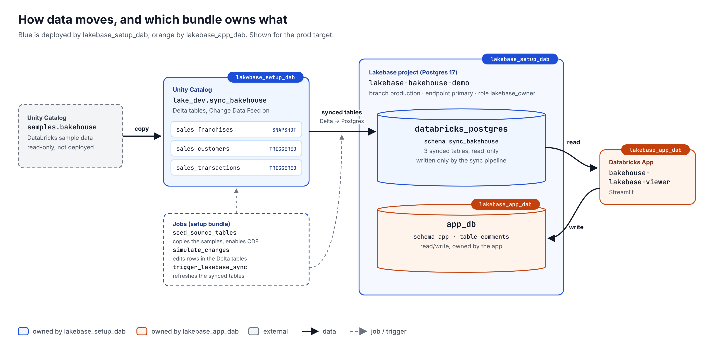

# databricks_lakebase

A small showcase of Lakebase (Databricks' managed Postgres): Delta tables are
synced into Lakebase, and a Databricks App reads them and writes its own data
to a separate database in the same Lakebase project. Sample data comes from
`samples.bakehouse`.

## Architecture



Data moves in three steps. Steps 2 and 3 both happen in the Lakebase project
`lakebase-bakehouse-demo`:

| Step | Where | What happens | Bundle |
|---|---|---|---|
| 1. Delta | Unity Catalog: `lake_dev.sync_bakehouse` | The `seed_source_tables` job, run during the first deploy, copies `samples.bakehouse` here and enables Change Data Feed | setup |
| 2. Lakebase | Postgres: `databricks_postgres.sync_bakehouse` | Synced tables copy the Delta tables onto the `production` branch, read-only | setup |
| 3. App | Postgres: `app_db.app.comments` | `bakehouse-lakebase-viewer` reads step 2 and writes comments to its own database | app |

The repo has two bundles, listed in deploy order. Deploy each one from its own directory,
and destroy them in reverse order.

1. **[`lakebase_setup_dab/`](lakebase_setup_dab/README.md)** creates the Lakebase
   project itself (`production` branch, endpoint, `databricks_postgres`), the Delta
   copies and the synced tables (table steps 1 and 2).
2. **[`lakebase_app_dab/`](lakebase_app_dab/README.md)** deploys the Streamlit app.
   It doesn't create a Lakebase project. It uses the one from the setup bundle,
   referenced by its id:
   - It adds a second database, `app_db`, to that project, where the app stores comments.
   - The app reads the synced tables from `databricks_postgres` and writes to `app_db`.
   - In `dev`, it also forks a per-user branch of the project (see [Environments](#environments)).

## Environments

There's one Lakebase project, and each environment is a **branch** of it:

| App bundle target | Branch | App | Data |
|---|---|---|---|
| `prod` | `production` | `bakehouse-lakebase-viewer` | Live synced tables + prod `app_db` |
| `dev` (default) | `dev-<user>`, created by the bundle | `bakehouse-viewer-<user>` | Copy of production at the time of the fork |

- **Freshness:** the dev branch is a snapshot. Sync pipelines only write to `production`.
- **Expiry:** the dev branch expires after 1 day, and the next `deploy -t dev` forks a fresh one.
- **Setup bundle:** it has only a `prod` target. That's deliberate: there is one Lakebase project, and environments are branches of it.

## Prerequisites

- Databricks CLI ≥ v0.294.0 and [`uv`](https://docs.astral.sh/uv/).
- A CLI login to your workspace. Use OAuth, because `databricks apps logs`
  doesn't work with a PAT:

  ```bash
  databricks auth login --host <WORKSPACE_URL> --profile <PROFILE>
  ```

- A `databricks.local.yml` at the repo root with your workspace URL. It's
  git-ignored, and both bundles include it:

  ```bash
  cp databricks.local.yml.example databricks.local.yml   # then set workspace.host
  ```

  The CLI picks the profile whose host matches, so commands below need no
  `--profile`. That also holds for non-bundle commands such as `databricks apps`
  or `databricks psql`, as long as you run them inside a bundle directory. The
  scripts read the same file. If several profiles share the host, also set
  `workspace.profile` there.

## Workflow

### First deploy

```bash
# 1. Sync infrastructure
cd lakebase_setup_dab
databricks bundle deploy               # also runs seed_source_tables before creating the synced tables

# 2. Prod app (creates app_db and the app's service principal)
cd ../lakebase_app_dab
databricks bundle deploy -t prod
databricks bundle run bakehouse_viewer -t prod

# 3. Grant the app read access to the synced tables (run from lakebase_setup_dab for its venv)
cd ../lakebase_setup_dab
uv run python ../lakebase_app_dab/scripts/grant_app_access.py \
  --project-id lakebase-bakehouse-demo --app-name bakehouse-lakebase-viewer
```

Find the app's URL with `databricks apps get <app name>`, run from either bundle directory.
Repeat step 3 whenever an app is created or recreated, because it gets a new service principal.

### Dev environment

```bash
cd lakebase_app_dab
databricks bundle deploy               # forks dev-<user>, creates bakehouse-viewer-<user>
databricks bundle run bakehouse_viewer
cd ../lakebase_setup_dab
uv run python ../lakebase_app_dab/scripts/grant_app_access.py \
  --project-id lakebase-bakehouse-demo --app-name bakehouse-viewer-<user> --branch dev-<user>
```

### Day to day

```bash
# In lakebase_setup_dab: change source rows, then push them to Lakebase
databricks bundle run simulate_changes
databricks bundle run trigger_lakebase_sync
uv run python scripts/check_lakebase.py --project-id lakebase-bakehouse-demo

# In lakebase_app_dab: try app changes on dev, then ship to prod
databricks bundle deploy && databricks bundle run bakehouse_viewer
databricks bundle deploy -t prod && databricks bundle run bakehouse_viewer -t prod
databricks apps logs <app name>
```

Before deploying a change to Lakebase resources, run `databricks bundle plan`.
A `delete` or `recreate` of a database, catalog or synced table means losing its data.

### Cleanup

Destroy the app bundle first, because `app_db` lives inside the setup bundle's project.

```bash
cd lakebase_app_dab && databricks bundle destroy && databricks bundle destroy -t prod
# If the synced tables fail to delete, remove the leftover "Synced table: lakebase-bakehouse-demo.*" pipelines by hand
cd ../lakebase_setup_dab && databricks bundle destroy
# Projects are soft-deleted for 7 days; to free the id immediately:
databricks postgres delete-project projects/lakebase-bakehouse-demo --purge
```

## Permissions

- **Synced tables** (`databricks_postgres.sync_bakehouse`): only the sync pipeline
  writes to them. Each app gets read access from `grant_app_access.py`.
- **App data** (`app_db.app`): the prod app creates this schema itself and owns it.
  A dev app works on a forked copy that still belongs to the prod app, so the
  grant script also gives it read/write access there.
- **Databases**: both are owned by the `lakebase-owner` role, which is defined
  in the setup bundle rather than tied to whoever deployed it.
- **`group_etl`**: example grants in the YAML (use the project, read the source
  schema, use the app).
