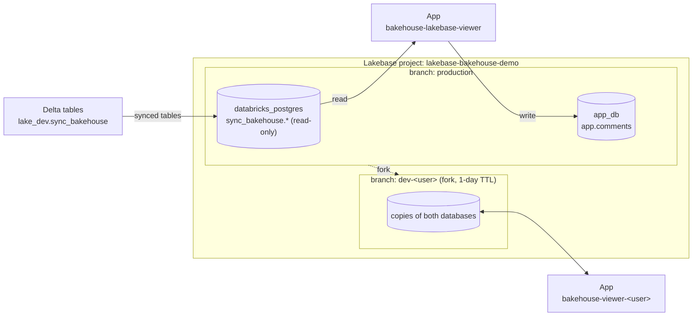

# databricks_lakebase

A small showcase of Lakebase (Databricks' managed Postgres): Delta tables are
synced into Lakebase, and a Databricks App reads them and writes its own data
to a separate database in the same Lakebase project. Sample data comes from
`samples.bakehouse`.

## Architecture



The repo has two bundles. Deploy each one from its own directory:

| Bundle | Owns |
|---|---|
| [`lakebase_setup_dab/`](lakebase_setup_dab/README.md) | Source schema and seed jobs, the Lakebase project, the `production` branch, `databricks_postgres` and the synced tables |
| [`lakebase_app_dab/`](lakebase_app_dab/README.md) | The app and its `app_db` database; in `dev`, also a per-user branch |

They're kept separate because each one has its own first-deploy step (see [Workflow](#workflow)).

## Environments

There's one Lakebase project, and each environment is a **branch** of it:

| App bundle target | Branch | App | Data |
|---|---|---|---|
| `prod` | `production` | `bakehouse-lakebase-viewer` | Live synced tables + prod `app_db` |
| `dev` (default) | `dev-<user>`, created by the bundle | `bakehouse-viewer-<user>` | Copy of production at the time of the fork |

- **Freshness:** the dev branch is a snapshot. Sync pipelines only write to `production`.
- **Expiry:** the dev branch expires after 1 day, and the next `deploy -t dev` forks a fresh one.
- **Setup bundle:** it has only a `prod` target. That's deliberate: there is one Lakebase project, and environments are branches of it.

## Prerequisites

- Databricks CLI ≥ v0.294.0 and [`uv`](https://docs.astral.sh/uv/).
- A CLI profile for the workspace. Commands below use `<PROFILE>` as a
  placeholder; check yours with `databricks auth profiles`. Use OAuth, because
  `databricks apps logs` doesn't work with a PAT:

  ```bash
  databricks auth login --host https://dbc-ea4bb8e5-6935.cloud.databricks.com --profile <PROFILE>
  ```

## Workflow

### First deploy

```bash
# 1. Sync infrastructure
cd lakebase_setup_dab
databricks bundle deploy --profile <PROFILE>               # synced tables may fail: sources don't exist yet
databricks bundle run seed_source_tables --profile <PROFILE>
databricks bundle deploy --profile <PROFILE>               # now creates the synced tables

# 2. Prod app (creates app_db and the app's service principal)
cd ../lakebase_app_dab
databricks bundle deploy -t prod --profile <PROFILE>
databricks bundle run bakehouse_viewer -t prod --profile <PROFILE>

# 3. Grant the app read access to the synced tables (run from lakebase_setup_dab for its venv)
cd ../lakebase_setup_dab
uv run python ../lakebase_app_dab/scripts/grant_app_access.py \
  --profile <PROFILE> --project-id lakebase-bakehouse-demo --app-name bakehouse-lakebase-viewer
```

Find the app's URL with `databricks apps get <app name> --profile <PROFILE>`.
Repeat step 3 whenever an app is created or recreated, because it gets a new service principal.

### Dev environment

```bash
cd lakebase_app_dab
databricks bundle deploy --profile <PROFILE>               # forks dev-<user>, creates bakehouse-viewer-<user>
databricks bundle run bakehouse_viewer --profile <PROFILE>
cd ../lakebase_setup_dab
uv run python ../lakebase_app_dab/scripts/grant_app_access.py --profile <PROFILE> \
  --project-id lakebase-bakehouse-demo --app-name bakehouse-viewer-<user> --branch dev-<user>
```

### Day to day

```bash
# In lakebase_setup_dab: change source rows, then push them to Lakebase
databricks bundle run simulate_changes --profile <PROFILE>
databricks bundle run trigger_lakebase_sync --profile <PROFILE>
uv run python scripts/check_lakebase.py --profile <PROFILE> --project-id lakebase-bakehouse-demo

# In lakebase_app_dab: try app changes on dev, then ship to prod
databricks bundle deploy --profile <PROFILE> && databricks bundle run bakehouse_viewer --profile <PROFILE>
databricks bundle deploy -t prod --profile <PROFILE> && databricks bundle run bakehouse_viewer -t prod --profile <PROFILE>
databricks apps logs <app name> --profile <PROFILE>
```

Before deploying a change to Lakebase resources, run `databricks bundle plan`.
A `delete` or `recreate` of a database, catalog or synced table means losing its data.

### Cleanup

Destroy the app bundle first, because `app_db` lives inside the setup bundle's project.

```bash
cd lakebase_app_dab && databricks bundle destroy --profile <PROFILE> && databricks bundle destroy -t prod --profile <PROFILE>
# If the synced tables fail to delete, remove the leftover "Synced table: lakebase-bakehouse-demo.*" pipelines by hand
cd ../lakebase_setup_dab && databricks bundle destroy --profile <PROFILE>
# Projects are soft-deleted for 7 days; to free the id immediately:
databricks postgres delete-project projects/lakebase-bakehouse-demo --purge --profile <PROFILE>
```

## Permissions

- **Synced tables** (`databricks_postgres.sync_bakehouse`): only the sync pipeline
  writes to them. Each app gets read access from `grant_app_access.py`.
- **App data** (`app_db.app`): the prod app creates this schema itself and owns it.
  A dev app works on a forked copy that still belongs to the prod app, so the
  grant script also gives it read/write access there.
- **Databases**: both are owned by the `lakebase-owner` role, which is defined
  in the setup bundle rather than tied to whoever deployed it.
- **`group_etl`**: example grants in the YAML (use the project, read the source
  schema, use the app).
